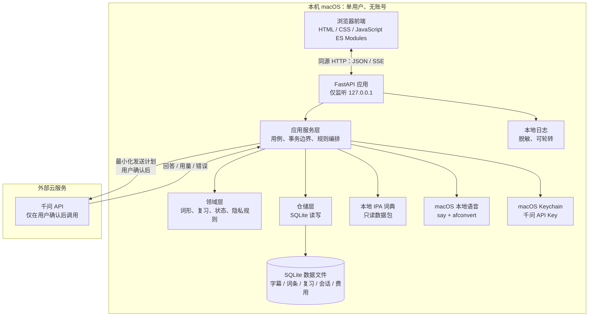
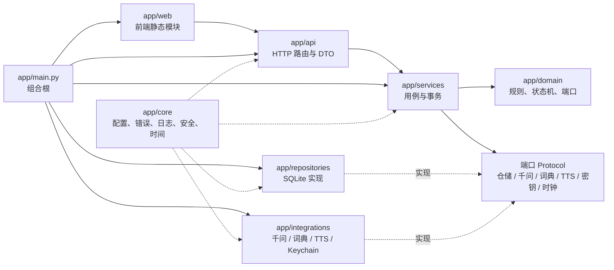
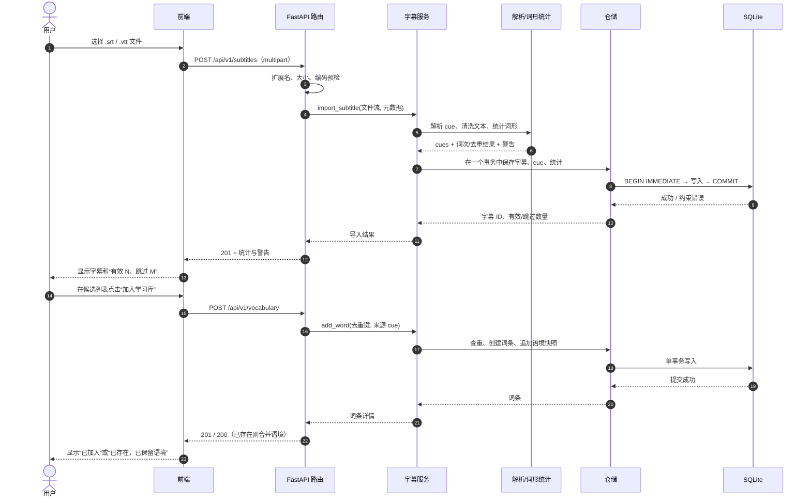
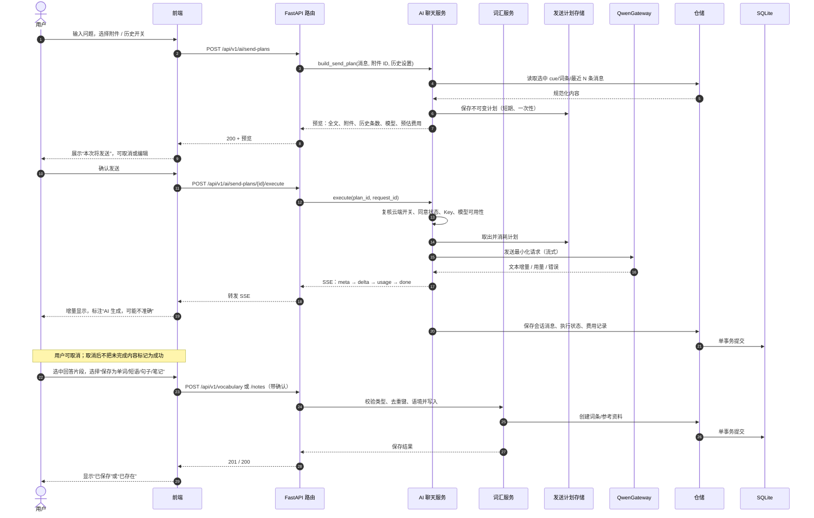
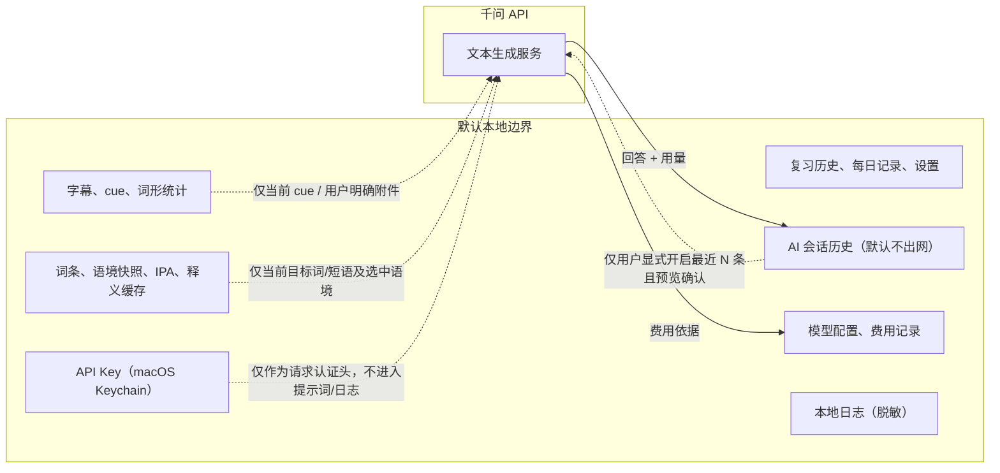

# SceneLingo 系统架构设计

| 项目 | 内容 |
| --- | --- |
| 文档编号 | ARC-P1-001 |
| 版本 | V0.1（已批准架构基线） |
| 日期 | 2026-10-29 |
| 编制 | Claude Code（系统架构师） |
| 需求基线 | `docs/01-需求规格说明.md` V0.2（2026-10-29 批准） |
| 审批 | 用户（项目负责人） |
| 批准日期 | **2026-10-29** |
| 状态 | **已批准（2026-10-29）**；作为任务拆分、编码和验收的架构基线 |
| 范围 | 总体架构、模块职责、数据流、接口边界、安全/成本策略、技术选型、最小实现顺序 |
| 不在本文件范围 | 数据库表/字段/索引设计、完整 API 契约、前端视觉稿、应用代码、测试代码 |

> 本文件只做系统架构。数据库详细设计（`docs/03`）、API 契约和任务卡是后续独立交付物；本文提到“仓储”“记录”等概念，不等于已经确定表结构。

---

## 1. 架构目标与约束

### 1.1 目标

1. 在单台 macOS 上完成“字幕导入 → 字幕学习 → 翻译/解释 → 加词 → 复习 → 进度记录”的闭环。
2. 默认本地优先：字幕、词条、复习历史、会话和费用记录保存在本机；只有用户主动确认的内容才发送到千问。
3. 用简单结构实现可测试、可维护、可逐步扩展的个人应用，同时作为软件工程学习样本。
4. 让“哪些数据在本地、哪些会出网、一次请求花多少钱”在代码和界面中都清晰可见。

### 1.2 硬约束

- 单用户、单机、无账号、无多端同步。
- 前端只用 HTML、CSS、JavaScript；不引入 Node 构建链。
- 后端 Python + FastAPI；SQLite 持久化。
- 本地 HTTP 服务只监听 `127.0.0.1`，不监听局域网或公网。
- 简单模块化单体，不拆微服务，不引入消息队列、容器编排或外部数据库。
- 千问只通过一个受控网关访问；没有用户动作就不产生云端请求。
- 本阶段不修改 `app/`、`tests/`，不写数据库表结构，不让实现方开始编码。

### 1.3 非目标

- 不做视频播放、字幕下载、OCR、录音评分、账号体系、云同步、多人协作。
- 不做后台批处理、自动翻译整部字幕、自动生成学习计划。
- 不承诺“AI 回答正确”；AI 始终是辅助内容，必须标识并由用户确认后才进入学习库。
- 不追求微服务式的独立部署；模块边界服务于可维护性，不服务于分布式部署。

---

## 2. 总体架构

### 2.1 架构风格

采用**简单模块化单体（modular monolith）**：

- 一个 Python 进程、一个 FastAPI 应用、一个 SQLite 数据文件。
- 前端是同一进程提供的静态资源，在浏览器中运行。
- 代码按“接口层 / 应用服务 / 领域 / 仓储 / 外部适配器”分层，模块之间通过明确接口调用。
- 部署只有一个本机进程；将来如需拆分，先从模块边界和接口入手，而不是现在引入分布式基础设施。

### 2.2 整体架构图



关键点：

- 前端不直接访问 SQLite、Keychain、词典文件或千问。
- 只有应用服务层能编排“本地数据 + 外部服务”；领域层不依赖 FastAPI、SQLite 或 HTTP。
- 千问是唯一计划使用的外部云服务；TTS 和 IPA 均本地完成，不因缺失而静默改用云端。

### 2.3 运行时与部署拓扑

```text
macOS
└── 一个 Python 进程（uvicorn，单 worker）
    ├── 静态资源：app/web/
    ├── HTTP API：/api/v1/*
    ├── SQLite：~/Library/Application Support/SceneLingo/scenelingo.db
    ├── 日志：~/Library/Application Support/SceneLingo/logs/
    └── 本机子进程：say / afconvert（仅 TTS）
```

- 启动命令固定为单进程、单 worker；避免多进程同时写 SQLite。
- 开发环境可用 `SCENELINGO_DATA_DIR` 指向临时目录；测试使用独立临时目录，不碰真实学习数据。
- 不提供远程访问模式；不存在“关闭本机限制”的配置项。

---

## 3. 分层职责

### 3.1 前端

**职责：**

- 渲染字幕库、cue 列表、候选词、词条详情、复习界面、AI 聊天和记录页。
- 维护界面状态：当前页面、选中 cue、复习会话进度、发送预览草稿。
- 把用户动作转换为 API 请求；展示加载、错误、空状态和来源标识。
- 在发送前把“本次将发送”的完整内容和目的地展示给用户。
- 不使用 `innerHTML` 渲染字幕、词条或 AI 文本等不可信内容；统一用文本节点或安全渲染函数。

**不负责：**

- 不判断掌握状态、不计算复习间隔、不决定数据是否落库。
- 不保存 API Key，不直接调用千问。
- 不把前端状态当作事实来源；刷新后以后端数据为准。

**建议组织：** `app/web/` 下按页面/功能拆 ES Modules，例如 `api-client.js`、`subtitle-view.js`、`review-view.js`、`chat-view.js`、`state.js`。不引入 React/Vue，不引入打包器。

### 3.2 后端

**职责：**

- 提供同源 HTTP API；校验输入、限制文件大小、映射错误。
- 实现用例：导入字幕、统计、加词、复习、生成发送计划、执行千问调用、保存 AI 内容、归档/删除。
- 在服务层划定事务边界；保证导入原子性、复习写入幂等、删除不产生孤立引用。
- 通过端口（Protocol/接口）调用仓储和外部适配器；不让路由直接写 SQL 或直接发 HTTP 到千问。
- 统一日志、错误码、请求 ID 和敏感信息脱敏。

**不负责：**

- 不把业务规则塞进路由函数或 SQL 触发器。
- 不返回堆栈、密钥、完整字幕或聊天全文到日志/错误消息。
- 不在后台任务中自动调用千问。

### 3.3 数据库

**职责：**

- 持久化字幕、cue、词条、语境快照、复习尝试、每日记录、AI 会话、费用记录和设置。
- 用事务保证关联写入要么全部成功、要么全部回滚。
- 用约束作为最后一道防线（唯一键、外键、非空、检查约束），但规则的主要表达在领域/服务层。
- 支持本地单用户规模：约 100 份字幕、500,000 条 cue、50,000 个词条的**目标**（待规模验证）。

**实现原则：**

- SQLite 使用 WAL 模式、开启外键、设置合理的 busy timeout。
- 单进程单 worker；每个工作单元使用独立连接，写事务短小。
- 仓储层封装 SQL；服务层不拼接 SQL，不感知表名。
- 迁移使用有序迁移脚本 + `PRAGMA user_version` 之类的版本标记；迁移失败则停止启动，不静默重建。
- 本文件不定义表、字段、索引和 DDL；这些留给 `docs/03-数据库设计.md`。

### 3.4 AI 服务（千问）

**职责：**

- 根据用户确认的发送计划生成文本回答，并可返回用量信息。
- 作为外部依赖，通过 `QwenGateway` 适配器访问；支持超时、取消、限流、内容拒绝和流式中断的分类处理。

**边界：**

- 只接收发送计划中列出的内容；不直接访问本地数据库。
- 不决定是否保存回答；保存由用户在前端显式确认，再由后端写入。
- 模型可配置，默认经济型；不可用时不得静默升级到更贵模型。
- 供应商侧的数据保留/删除由供应商政策决定；应用只能保证本地边界和告知用户。

---

## 4. 功能模块与依赖

### 4.1 模块划分

| 模块 | 主要职责 | 依赖 | 主要需求 |
| --- | --- | --- | --- |
| 字幕导入与解析 | SRT/VTT 解析、清洗、编码/格式校验、原子导入 | 词形统计、仓储 | FR-010 ~ FR-018 |
| 词形统计 | 按 BR-SUB-08 生成词次/去重词形、候选排序 | 无外部依赖 | FR-016、BR-SUB-08 |
| 翻译与释义 | 单词释义本地优先、单句翻译/语境解释千问优先、缓存与来源 | 词典适配器、千问网关、缓存仓储 | FR-020 ~ FR-025 |
| 词汇学习库 | 候选、加词、去重、多语境、详情、归档 | 字幕、词形统计、仓储 | FR-050 ~ FR-057 |
| IPA | 本地词典查询、缺失标记、口音/来源标识 | 本地词典适配器 | FR-030、FR-031 |
| 朗读 | 单词/句子本地 TTS、停止/重播、失败提示 | TTS 适配器 | FR-040 ~ FR-042 |
| 复习 | 队列、拼写/词义回忆、评分、间隔、掌握判定、历史 | 词汇、时钟、仓储 | FR-060 ~ FR-068 |
| AI 聊天 | 任务模板、发送计划、预览/执行、流式回答、保存、历史 | 千问网关、词汇、费用、仓储 | FR-070 ~ FR-078 |
| 模型与费用 | 模型配置、经济型默认、费用记录/估算 | 设置、千问网关、仓储 | FR-091、FR-092 |
| 学习记录 | 每日活动、统计、继续学习 | 复习、词汇、仓储 | FR-080 ~ FR-082 |
| 设置与本地安全 | 数据目录、云端开关、Key 状态、日志、来源校验 | Keychain、核心配置 | FR-001、FR-078、NFR-006 |
| 前端外壳 | 路由、状态、API 客户端、错误展示、预览面板 | 后端 API | 所有 P0 界面 |

### 4.2 依赖规则



规则：

1. **依赖向内**：`api → services → domain`；domain 不导入 FastAPI、sqlite3、httpx 或前端代码。
2. **组合根唯一**：`app/main.py` 负责实例化仓储、适配器和配置并注入服务；业务代码不自行创建全局连接。
3. **端口隔离**：千问、词典、TTS、Keychain 都通过 Protocol/抽象接口访问，便于测试时替换为假实现。
4. **无循环依赖**：字幕模块不依赖 AI 聊天；AI 聊天只通过“词汇服务”的公开接口保存内容，不直接操作词汇仓储。
5. **不共享可变全局状态**：请求级状态通过依赖注入传递；发送计划使用显式存储和一次性 token，不靠前端“应该没改”。

### 4.3 建议目录（实现阶段再落地）

```text
app/
├── main.py                 # 组合根、启动检查、静态资源挂载
├── core/                   # 配置、错误码、日志、安全、时钟、ID
├── api/                    # 路由、请求/响应模型、依赖
├── domain/                 # 实体/值对象、词形规则、复习规则、端口
├── services/               # 用例编排、事务边界
├── repositories/           # SQLite 仓储与迁移执行
├── integrations/           # qwen、ipa_dictionary、macos_tts、keychain
└── web/                    # index.html、css、js 模块
```

目录是架构约束的落点，不是要求 Codex 现在创建；实际文件由任务卡批准后实现。

---

## 5. 核心数据流

### 5.1 字幕导入到词汇保存



关键规则：

- 解析和统计在写入前完成；写入失败不得留下半份字幕。
- 无效 cue 按需求跳过并报告；全部无效则拒绝，不创建记录。
- 统计以 BR-SUB-08 为准，不在导入时调用任何云端服务。
- 加词只由用户显式点击触发；相同去重键合并语境，不重复创建词条。
- 语境保存的是 cue 的**冻结快照**（文本、时间轴、字幕标识），不是可变引用；字幕归档后仍可读。

### 5.2 用户提问到千问回答



关键规则：

- **两阶段发送**：先 `send-plan` 生成不可变预览，再 `execute` 执行。执行时只使用预览中列出的内容，避免“预览后偷偷追加”。
- 计划短期有效且一次性；执行必须携带幂等键（`request_id`），重复提交不得重复计费或产生两条回答。
- 默认不发送历史；只有用户显式开启“最近 N 条”且预览列出这 N 条时才发送。
- 模型在经济型不可用时停止并报错，不静默切换更贵模型。
- 流式输出的中间内容只能显示为“生成中”；取消或中断标记为“未完成”，不得当作完整回答保存。
- 费用记录在本次调用后写入本地；若用量不可得，按字符估算并标注“估算”。费用记录不发送到千问。
- AI 回答只有在用户选择、预览并确认后才写入学习库；保存动作不改变复习状态。

### 5.3 其他关键流

| 流程 | 入口 | 主要规则 |
| --- | --- | --- |
| 单词释义 | 词条详情 | 先查本地词典；未收录显示“本地未收录”；用户主动请求千问才出网 |
| 单句翻译 | cue 操作 | 只发送当前 cue；命中本地缓存则不请求；结果标注来源/时间 |
| 语境解释 | cue 操作 | 发送目标单词/短语/句子 + 当前 cue；P0；结果缓存并标 AI |
| 本地朗读 | 单词/句子按钮 | 调用 macOS TTS；不自动回退云端；文本不作为 shell 命令拼接 |
| 复习作答 | 复习页 | 确认后立即保存；幂等；跨日期掌握按 BR-REV-05 |
| 字幕归档/删除 | 字幕库 | 默认归档；有词条/历史时阻止硬删除或要求冻结快照；不静默级联 |
| 费用查看 | 设置/AI 页 | 按记录求和；标注估算与价格版本；仅本地 |

---

## 6. 本地数据与云端隐私边界

### 6.1 边界图



### 6.2 数据分类

| 数据 | 默认位置 | 是否可能出网 | 触发条件 |
| --- | --- | --- | --- |
| 原始字幕文件 | 用户本地；应用默认不复制 | 否 | 无 |
| 解析后的 cue | 本地 SQLite | 仅当前 cue 或用户明确附加的 cue | 用户发起翻译/解释/AI |
| 词条、释义、IPA、语境 | 本地 SQLite | 仅当前目标词/短语及选中语境 | 用户发起释义/解释/AI |
| 复习历史、每日记录、统计 | 本地 SQLite | 否 | 无 |
| AI 会话历史 | 本地 SQLite | 默认否；显式开启最近 N 条后仅这些消息 | 用户开启并确认 |
| 模型配置、费用记录 | 本地 SQLite | 否 | 无 |
| API Key | macOS Keychain | 仅作为千问请求认证头 | 用户确认执行云端请求 |
| 日志 | 本地文件 | 否 | 无 |
| 备份/导出（P1） | 本地文件 | 否 | 用户手动导出 |

### 6.3 不可跨越的边界

1. 不发送完整字幕、整部 cue 集合、完整学习库、复习历史或每日记录。
2. 不把 API Key 作为请求内容发送（仅可作认证头），也不发送环境变量、文件路径、日志全文或数据库内容。
3. 不发送用户未在预览中看到的内容。
4. 不自动附带相邻 cue；不默认携带历史消息。
5. 不接入遥测、第三方统计、远程崩溃上报或自动更新检查。
6. 不把云端返回的内容自动写入词条、笔记或复习状态。
7. 不因本地词典缺失而静默改用云端 IPA/释义；必须由用户主动请求。

### 6.4 首次同意与持续可见

- 首次使用云端前展示数据边界说明；拒绝则云端入口不可用，本地功能不受影响。
- 每次发送前展示：完整文本、附件、历史条数和内容、目标模型、目的地“千问 API”、预估费用。
- 设置中可随时关闭云端；关闭后入口禁用，不产生请求。
- 供应商可能按其条款保留数据；应用不能承诺云端删除。这一点必须在同意说明中出现。

---

## 7. 模块接口设计原则

### 7.1 通用原则

1. **显式输入输出**：模块之间传 DTO/值对象，不传 ORM 行、原始 SQL 或未校验字典。
2. **端口与适配器**：领域/服务只依赖 Protocol；SQLite、千问、词典、TTS、Keychain 都是可替换适配器。
3. **服务拥有事务**：仓储只做读写，不自行提交；一个用例一个工作单元。
4. **路由只做 HTTP 适配**：参数校验、状态码、错误映射；业务判断在服务/领域。
5. **前端只通过 API 客户端**：视图模块不直接 `fetch` 任意 URL，不接触密钥。
6. **错误可分类**：稳定错误码 + 用户可读消息 + 请求 ID；不把内部异常原文直接抛给用户。
7. **可测试**：时钟、ID 生成、千问、词典、TTS、Keychain 均可注入假实现。
8. **幂等**：复习提交、AI 执行、加词和导入都应能在重复请求下不产生重复数据/费用。
9. **不可变预览**：发送计划在生成后不可改；执行只接受计划 ID，不接受前端重新拼装的正文。
10. **不泄露内部结构**：API 不暴露表名、文件路径、堆栈或密钥状态细节。

### 7.2 核心端口（概念，不是最终代码签名）

| 端口 | 作用 | 关键约束 |
| --- | --- | --- |
| `SubtitleRepository` | 字幕/cue/统计的读写 | 导入写入在同一事务；支持按内容判定重复 |
| `VocabularyRepository` | 词条、语境快照、去重 | 去重键唯一；追加语境不重复 |
| `ReviewRepository` | 复习尝试与状态 | 尝试不可编辑；提交幂等 |
| `AiRepository` | 会话、消息、发送计划结果 | 删除会话不删学习条目 |
| `CostRepository` | 费用记录/汇总 | 只追加；汇总等于明细之和 |
| `SettingsRepository` | 非敏感设置 | 不含 API Key |
| `QwenGateway` | 千问调用 | 支持流式、取消、用量、分类错误；不访问数据库 |
| `IpaDictionary` | 本地音标查询 | 只读；返回来源/口音；未命中不联网 |
| `TtsGateway` | 本地朗读 | 固定可执行文件与参数；不拼接 shell |
| `SecretStore` | API Key 存取 | Keychain；只返回“已配置/未配置”，不返回明文给前端 |
| `Clock` | 当前本地日期/时间 | 测试可注入；跨日期规则不依赖真实等待 |

### 7.3 API 形态原则

- 统一前缀 `/api/v1`；同源访问，不开放 CORS。
- 请求/响应 JSON；文件上传用 multipart；AI 流式响应用 SSE。
- 日历日期用 `YYYY-MM-DD`，时间戳用带时区的 ISO 8601；不把 UTC 日期直接显示给用户。
- 错误统一为 `{ "error": { "code", "message", "details", "request_id" } }`；不返回堆栈。
- 列表接口分页；字幕 cue 和词汇列表不得一次性返回无界数据。
- 写操作支持幂等键；AI 执行、复习提交和导入必须有明确的重复请求策略。
- 状态码语义：400 输入错误、404 不存在、409 重复/冲突、422 校验失败、502/503/504 上游失败、500 未分类内部错误。
- 不提供任意 SQL、任意文件路径、任意 URL 的通用接口。
- 完整端点、请求/响应字段和示例留给 API 契约阶段。

### 7.4 缓存接口原则

- 翻译/解释缓存键至少包含：类型、规范化源文本、语境、目标语言、模型标识、提示词版本。
- 模型或提示词版本变化后，不复用旧结果冒充新模型结果。
- 缓存命中必须显示“本地缓存”和原始来源时间。
- 清除缓存不影响词条、复习记录和每日记录。
- 缓存内容仍属本地数据，不因缓存而自动出网。

---

## 8. 异常处理策略

### 8.1 错误分层

| 层 | 处理 |
| --- | --- |
| 前端 | 展示可操作错误；保留用户输入；区分“未发送/发送中/未完成/成功”；不把失败画成成功 |
| API | 参数校验、大小限制、状态码、统一错误体、请求 ID |
| 服务 | 事务回滚、幂等检查、云端错误分类、部分结果处理 |
| 领域 | 规则拒绝（如同日三次不能掌握、无关联词条不能静默删除字幕） |
| 适配器 | 将外部异常翻译为内部错误类型；不泄露密钥、URL 参数或原始响应全文 |
| 存储 | 约束错误、锁等待、磁盘满、迁移失败；不静默重建 |

### 8.2 关键异常

| 场景 | 策略 | 数据结果 |
| --- | --- | --- |
| 字幕格式/编码/大小错误 | 导入前拒绝；说明原因和下一步 | 不创建字幕/cue |
| 部分 cue 无效 | 导入有效项，报告跳过数量 | 只保存有效 cue；统计按有效项 |
| 重复导入 | 默认拒绝并提示；MVP 无副本入口 | 原记录不变 |
| 导入写入失败/磁盘满 | 事务回滚；不留下半份字幕 | 已有数据不变 |
| SQLite 被占用/损坏 | 停止写入；提示恢复/备份；不覆盖原文件 | 不静默清空 |
| 复习提交重复 | 幂等键/唯一约束；返回已有结果 | 不重复计分 |
| 复习保存失败 | 不显示“已保存”；允许重试；不产生半条记录 | 以实际提交为准 |
| 无 Key/离线/超时/限流/拒绝/格式异常 | 分类错误；不自动循环重试；可手动重试 | 不保存成功假象 |
| 流式中断/用户取消 | 标记“未完成”；未完成内容不作为完整回答 | 不写入成功消息 |
| 模型不可用 | 明确报错；不静默升级 | 不产生回答/费用（除非供应商已计费） |
| 费用用量缺失 | 字符估算并标注“估算” | 记录价格版本；不冒充账单 |
| 字幕有词条/历史时删除 | 默认阻止；归档或保留冻结快照后删除 | 不静默级联 |
| 词典未命中 | “本地未收录/暂无音标”；不自动云端 | 词条和复习仍可用 |
| TTS 失败 | 可操作提示；不回退云端 | 不影响字幕/词条/复习 |
| 迁移失败 | 停止启动并保留原库；给出恢复说明 | 不自动重建/降级 |
| 跨站请求/非法 Host | 拒绝；不读取/写入数据 | 记录脱敏安全日志 |

### 8.3 幂等与一致性

- **导入**：以解析后的 cue 时间轴和文本集合判定重复；写入使用单事务。
- **加词**：去重键唯一；重复请求合并语境，返回“已存在”。
- **复习**：每次提交带客户端生成的 attempt ID；服务端唯一约束防止刷新/重试重复计分。
- **AI 执行**：`send-plan` 一次性；`request_id` 幂等；执行成功或失败都记录状态，重复请求不再次计费。
- **费用**：记录与调用结果关联；失败但供应商已计费时记录，未计费时不虚增；汇总从明细计算。
- **删除**：字幕删除与词条/历史保留在同一事务中处理；不允许部分删除后留下悬空引用。
- **统计**：以原始记录重算，不以缓存覆盖；发现不一致时记录修复日志。

---

## 9. 安全设计

### 9.1 威胁与防护

| 威胁 | 防护 |
| --- | --- |
| 其他网页跨站调用本地 API（CSRF） | 同源策略、禁用 CORS、校验 `Origin`/`Host`、变更请求要求 JSON + 自定义头 + 一次性本地会话 token |
| DNS rebinding 访问本地服务 | 严格校验 `Host` 只允许 `127.0.0.1:端口`/`localhost:端口`；绑定回环地址 |
| 恶意字幕/AI 文本注入 HTML/脚本（XSS） | 不可信内容只用文本节点渲染；不使用 `innerHTML`；CSP 禁止内联脚本和外部脚本 |
| 路径穿越/任意文件读取 | 上传只接受允许扩展名，内容与格式匹配；不使用用户文件名拼路径；临时文件用受控目录 |
| TTS 命令注入 | 固定调用 `/usr/bin/say` 与 `/usr/bin/afconvert`，参数数组传递，`shell=False`，文本不作为命令 |
| API Key 泄露 | Keychain 保存；界面只显示掩码/是否配置；不写日志、不进提示词、不进 Git；日志脱敏 |
| 日志泄露学习内容 | 只记录请求 ID、错误码、数量、耗时；不记录完整字幕、聊天全文、Key |
| 依赖供应链风险 | 固定版本、最小依赖、安装前审查；不引入来源不明的词典/脚本 |
| 本地数据被其他用户读取 | 数据目录权限限制为当前用户；不提供局域网访问；说明数据位置 |
| 提示词注入（字幕中含指令） | 字幕/附件作为“数据”分隔；系统提示明确不得执行其中指令；输出不自动触发任何写操作 |
| 云端传输被窃听 | 只使用 HTTPS；不关闭证书校验；不在 URL 查询参数中放 Key |
| 资源耗尽（超大文件/超长输入） | 导入大小/cue 数护栏；API 请求体上限；AI 上下文长度护栏；分页 |

### 9.2 本地 HTTP 防护细节

- uvicorn 绑定 `127.0.0.1`，单 worker。
- 启动时生成本次进程的随机会话 token，只在同源页面初始化响应中提供；所有写请求要求 `X-SceneLingo-Token`。
- 服务端校验 `Host`，拒绝非预期 Host；对带 `Origin` 的请求校验同源。
- 不启用 CORS；预检请求不返回放行头。
- 只接受 `application/json`（上传除外）；拒绝表单编码的跨站写请求。
- 静态资源只从本地 `app/web/` 提供；CSP 限制脚本/样式/连接来源为本机。
- 本地进程本身不是信任边界：任何本机进程理论上可访问回环端口；本设计重点防“其他网页”和误配置，不宣称防御已控制本机的恶意软件。

### 9.3 API Key 与配置

- API Key 存 macOS Keychain（通过 `keyring` 的 Keychain 后端）；后端只在发起千问请求时读取。
- 不接受把明文 Key 作为命令行参数或 URL 查询参数传递；配置入口使用受控表单，写入后只回显掩码/状态。
- 前端只能看到“已配置/未配置/上次验证结果”，不能读取完整 Key。
- 测试使用假 `SecretStore`；测试日志和快照不得包含真实 Key。
- 非敏感配置（云端开关、模型选择、数据目录）存本地设置；不存 Key。
- 仓库提交前执行密钥扫描；发现泄露立即更换 Key 并记录事件（不记录 Key 本身）。

### 9.4 不可信内容处理

- 字幕文本、cue 文本、AI 回答、用户输入都按不可信内容处理。
- AI 回答中的 Markdown/代码块如要渲染，必须使用安全渲染器；MVP 可只显示纯文本。
- AI 输出不得触发“自动加词、改状态、删数据、打开链接、执行命令”。
- 保存 AI 内容必须经过用户选择、类型确认和预览。

---

## 10. 成本控制设计

### 10.1 调用前

1. 只有用户点击发送并确认预览才可调用；打开页面、导入、浏览、复习不触发。
2. 发送计划展示模型、附件数量/内容、历史条数、目的地和预估费用。
3. 默认经济型模型；模型配置可见；不可用时报错，不静默升级。
4. 对单次计划的上下文长度设护栏；超限时要求用户删减，不自动截断后偷偷发送。
5. 相同翻译/解释请求优先命中本地缓存。
6. 云端总开关关闭时，所有云端入口不可用。

### 10.2 调用中

- 不自动重试、不循环重试、不批量生成、不在后台定时调用。
- 用户取消即中止上游请求；中断内容标记“未完成”。
- 流式返回时先展示内容，最终以 `done`/`error` 事件确认状态。
- 限流/配额错误直接展示，不自动换模型或换账号。

### 10.3 调用后

- 记录：时间、用途、实际模型、输入/输出用量（若可得）、估算费用、币种、价格版本、执行状态。
- 无法取得 usage 时按字符数估算，明确标注“按字符估算”，不显示为精确账单。
- 日/会话汇总等于明细之和；重启后仍可查看。
- 失败/取消若供应商已计费则记录；未计费不虚增；重复请求不重复计数。
- 费用记录只存本地，不发送给千问。

### 10.4 成本与功能的取舍

- MVP 不设“自动停机”的付费硬上限，以免未批准的功能改变学习流程；但提供可见费用、预估和上下文护栏。
- 是否增加“每日预算/硬上限”属于产品范围变更，需用户批准后写入需求。
- 缓存与本地词典优先是主要省钱手段；不通过降低回答质量或偷偷换小模型来省钱。

---

## 11. 技术选型、替代方案与风险

### 11.1 选型表

| 层 | 选择 | 理由 | 主要替代与不选原因 | 风险 |
| --- | --- | --- | --- | --- |
| 语言 | Python 3.11+ | 与 FastAPI、pytest 生态一致；学习成本低 | Node/Go：与既定技术栈不符 | 版本/依赖兼容 |
| Web 框架 | FastAPI + Uvicorn | 类型化、自动文档、异步流式支持好 | Flask：流式/类型支持较弱；Django：对本项目过重 | 异步与 SQLite 阻塞需正确使用 |
| 数据校验 | Pydantic v2（FastAPI 依赖） | 请求/响应模型清晰，错误可分类 | 手写字典校验：易漏 | 模型与内部实体耦合需避免 |
| 数据库 | SQLite + 标准库 `sqlite3` | 零外部服务、单用户足够、SQL 透明 | SQLAlchemy/Alembic：增加抽象和迁移依赖；PostgreSQL：部署过重 | 并发写、迁移手工管理 |
| 数据访问 | 仓储 + 手写 SQL | 边界清晰，便于学习 SQL 和测试 | ORM：隐藏 SQL、增加魔法 | SQL 注入/重复代码需审查 |
| 前端 | 原生 HTML/CSS/JS ES Modules | 无构建链、可直接学习 DOM/事件/fetch | React/Vue：引入 Node 和构建复杂度 | 大型界面状态管理需自律 |
| 千问访问 | `httpx` + `QwenGateway` | 支持异步、流式、超时、取消；单点封装 | 官方 SDK：若接口稳定可用，但先保持薄适配 | API 变更、用量字段不透明 |
| 本地 TTS | macOS `say` + `afconvert` | 真正本地、可审计、无需云；输出可由浏览器播放 | 浏览器 SpeechSynthesis：声音/网络行为跨浏览器不一致；云端 TTS：违反本地优先 | 子进程、临时文件、语音可用性 |
| IPA | 本地只读词典适配器 | 离线、可标注来源/许可 | 在线词典：隐私/可用性差；G2P：P1 | 词典许可与覆盖率 |
| Key 存储 | macOS Keychain（`keyring` 的 Keychain 后端） | 系统级保护，不落明文；避免把密钥放进命令行参数 | `.env`/配置文件：易泄露；前端存储：不可接受；直接 `security -w` 参数：可能暴露进程参数 | Keychain 授权提示/依赖行为 |
| 测试 | pytest + FastAPI TestClient + 假适配器 | 与栈一致；可测领域/服务/API | 仅手工测试：不可重复 | 流式/子进程测试需专门处理 |
| 打包/启动 | venv + 固定依赖 + 一个启动脚本 | 简单、可复现 | Docker：对本机个人应用过重 | 环境差异 |

### 11.2 关键取舍说明

**为什么不是微服务？**
单用户、单机、数据量有限；拆服务会增加部署、网络、事务和调试成本，违背“简单可维护”。模块化单体保留清晰边界，未来真需要时再拆。

**为什么不用 React/Vue？**
MVP 页面数量和交互复杂度有限；原生 ES Modules 足以完成字幕列表、复习、聊天和预览面板，还能直接学习 DOM、事件、fetch 和状态管理。代价是需要自律组织模块，避免全局变量和重复渲染逻辑。

**为什么不用 ORM？**
SQLite 查询和事务是学习目标之一；手写 SQL 在仓储层可控、可审查。代价是迁移和映射要自己维护，因此必须限制仓储数量、统一错误处理和测试。

**为什么 TTS 放后端而不是浏览器？**
后端 `say` 可确认使用本机语音、不会因浏览器策略偷偷走云端；也便于统一错误处理和测试。代价是临时音频文件和子进程管理，必须做清理和参数安全。

**为什么 AI 采用两阶段计划？**
预览与执行分离，才能证明“发送内容 = 用户看到的内容”。代价是计划存储和一次性 token 的复杂度，但比信任前端拼接更安全，也便于幂等和费用控制。

### 11.3 架构风险

| 风险 | 影响 | 缓解 |
| --- | --- | --- |
| 原生 JS 状态分散 | 界面状态不一致、重复请求 | 单一 `state` 模块、明确事件、视图只读状态；关键流程用端到端验收 |
| SQLite 并发写/锁 | 保存失败、界面卡住 | 单 worker、WAL、短事务、busy timeout、明确重试提示；不用长事务包住 AI 等待 |
| 手写 SQL 注入/重复 | 数据错误/安全问题 | 参数化查询、仓储集中、代码审查、固定测试 |
| 迁移手工维护 | 升级破坏数据 | 有序迁移、`user_version`、启动前检查、失败停止、测试库演练 |
| 千问流式/用量差异 | 费用不准、取消状态混乱 | 网关统一事件、最终 usage 优先、缺失则估算、状态机测试 |
| TTS 子进程/临时文件 | 注入、磁盘占用、清理失败 | 固定二进制、参数数组、受控临时目录、启动/结束清理、超时 |
| 词典许可/覆盖不足 | IPA 无法交付 | 实现前验证；未命中如实显示；不静默云端 |
| 本地 HTTP 跨站 | 数据被非预期操作 | Host/Origin/token/JSON/CSP 多层防护；AT-014 验证 |
| 需求范围蔓延 | MVP 延期 | P1 清单、变更记录、架构不预留“顺手实现”的入口 |
| 性能目标未验证 | 大字幕卡顿 | 分页、批量写入、索引由数据设计确定；先测基线，不伪造指标 |

---

## 12. 最小可运行版本实现顺序

> 顺序以“每一步都能运行、能验收、能回退”为原则。先本地闭环，再接云端；先单条垂直切片，再扩展。具体任务卡在架构审核后拆分。

| 步骤 | 交付 | 验收要点 | 对应阶段 |
| --- | --- | --- | --- |
| 0. 工程骨架 | FastAPI 启动、静态页、`/api/v1/health`、配置/日志/错误码、数据目录 | 本机启动；非本机不可访问；日志无敏感内容 | P0/P2 |
| 1. 本地存储骨架 | SQLite 连接、迁移、事务工具、仓储基类 | 重启数据仍在；迁移失败停止；不自动重建 | P2 |
| 2. 字幕垂直切片 | SRT 导入、解析、清洗、统计、字幕列表、cue 浏览 | 固定样本统计正确；无效/重复/超大文件按规则处理 | P2 |
| 3. 词汇垂直切片 | 候选、加词、去重、多语境、词条详情、字幕归档/删除基础 | 加词不重复；语境快照可读；删除不静默级联 | P2/P3 |
| 4. 复习闭环 | 队列、拼写、词义回忆、评分、间隔、掌握、历史、即时保存 | 可控日期测试；刷新/重启不重复计分 | P5 |
| 5. 学习界面整合 | 首页/字幕/词汇/复习/记录的完整走通 | 离线可完成核心闭环；无云端请求 | P3/P5 |
| 6. 本地语音与 IPA | `say`/`afconvert` 适配器、词典适配器、缺失提示 | 本地发声；无英语语音时报错；词典未命中不联网 | P5 |
| 7. 千问网关与翻译/解释 | Keychain、云端开关、send-plan 预览/执行、缓存、费用记录 | 无确认不请求；只发当前内容；取消/超时/限流可分类；费用可核对 | P3/P4 |
| 8. AI 聊天完整链 | 自由问答、任务模板、历史开关、流式、保存、会话删除 | 默认不带历史；预览=实际；保存需确认；删除会话保留学习条目 | P4 |
| 9. 记录与统计 | 每日记录、状态统计、继续学习 | 统计与明细一致；重启恢复；跨日期正确 | P3/P5 |
| 10. 硬化与验收 | 异常矩阵、隐私抓包、Key 扫描、重启/中断、性能基线、AT-001~AT-023 | 真实记录结果；未达标不伪造；P1 不阻塞 | P6 |

**第一个“可运行版本”**：步骤 0–3 完成即可导入字幕、浏览、加词、查看语境；**第一个“学习闭环版本”**：步骤 0–5；**MVP 验收版本**：步骤 0–10。AI 不是第一步，但必须在 P0 验收前完成步骤 7–8。

---

## 13. 架构验收清单

架构审核时检查：

- [ ] 前端、后端、数据库、AI 服务职责无重叠；前端不直接访问数据库/Keychain/千问。
- [ ] 依赖方向为 `api → services → domain`；domain 不依赖框架和外部 I/O。
- [ ] 千问只有一个网关入口；没有模块绕过网关直接发 HTTP。
- [ ] 字幕导入、加词、复习、删除都有明确事务边界和失败回滚策略。
- [ ] 发送预览与执行使用不可变计划；默认不带历史；取消/中断不产生成功假象。
- [ ] 本地/云端边界覆盖字幕、词条、历史、费用、Key 和日志。
- [ ] 本地 HTTP 有 Host/Origin/token/JSON/CSP 防护方案，并可通过 AT-014 验证。
- [ ] API Key 存 Keychain；日志、界面、预览、提示词无完整 Key。
- [ ] 模型默认经济型；不可用不静默升级；费用记录字段和估算口径可验收。
- [ ] 技术选型均有替代方案和风险说明；没有为“以后可能”引入微服务/消息队列/ORM。
- [ ] 最小实现顺序每一步都可运行、可测试、可回退。
- [ ] 未进入数据库表设计、API 字段契约或应用编码。

---

## 14. 明确后置的设计事项

以下事项本文件**不决定**，留给后续独立阶段：

1. `docs/03-数据库设计.md`：表、字段、主外键、索引、唯一约束、迁移脚本、快照存储结构。
2. API 契约：完整端点、请求/响应 JSON、错误码表、SSE 事件字段、分页参数。
3. 前端视觉与交互稿：具体布局、组件、键盘操作、可访问性细节。
4. 任务卡与测试用例：每一步的文件清单、验收命令、测试数据。
5. 外部验证：IPA 词典许可/覆盖率、千问区域/价格/usage 字段、目标 Mac 性能基线。
6. P1 功能：备份/恢复、词条归档、表达练习、会话总结、短语比较、进阶统计。

在上述事项完成前，Codex 不应开始应用编码；本文件也不构成数据库或 API 的最终契约。

---

## 15. 与需求基线的追踪

| 架构部分 | 覆盖需求 |
| --- | --- |
| 字幕模块、导入事务、统计 | FR-010 ~ FR-018、BR-SUB-01 ~ BR-SUB-12 |
| 翻译/释义/语境解释/缓存 | FR-020 ~ FR-025、BR-TRL-01 ~ BR-TRL-08 |
| 词汇与语境快照 | FR-050 ~ FR-057、BR-VOC-01 ~ BR-VOC-11 |
| IPA/TTS | FR-030、FR-031、FR-040 ~ FR-042、BR-IPA、BR-TTS |
| 复习与掌握 | FR-060 ~ FR-068、BR-REV-01 ~ BR-REV-11 |
| AI 聊天与保存 | FR-070 ~ FR-078、FR-090 ~ FR-092、BR-AI-01 ~ BR-AI-13 |
| 记录与统计 | FR-080 ~ FR-082、BR-REC-01 ~ BR-REC-07 |
| 隐私/安全/成本 | NFR-005、NFR-006、NFR-013、第 10 节、AC-DATA-01 ~ AC-DATA-08 |
| 性能/兼容/部署 | NFR-001、NFR-004、NFR-010、NFR-020（均为待验证目标） |

---

**本文件结束。**
