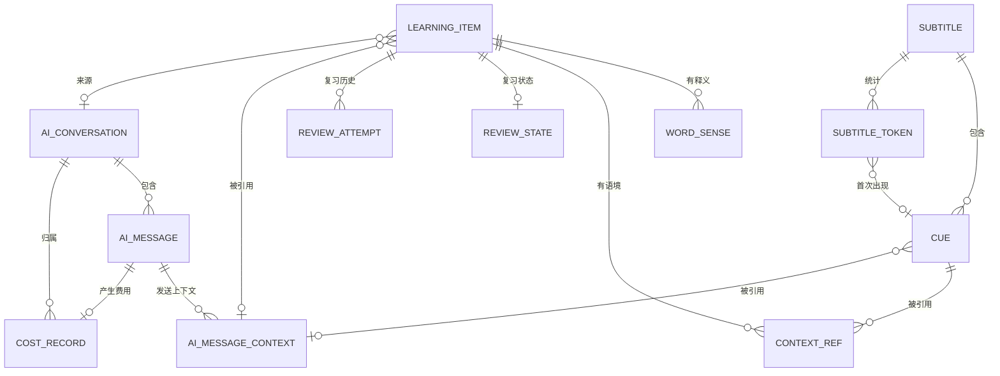

# SceneLingo 数据库设计（逻辑模型）

| 项目 | 内容 |
| --- | --- |
| 文档编号 | DBD-P1-001 |
| 版本 | V0.1（原则批准的候选基线） |
| 日期 | 2026-10-29 |
| 编制 | Claude Code（系统架构师） |
| 需求基线 | `docs/01-需求规格说明.md` V0.2（2026-10-29 批准） |
| 架构基线 | `docs/02-系统架构设计.md` V0.1（2026-10-29 批准） |
| 审批 | 用户（项目负责人） |
| 批准日期 | **2026-10-29（原则批准）** |
| 状态 | **原则批准**，作为 V0.1 候选基线；物理表结构与迁移脚本随任务卡逐项确认 |
| 范围 | 实体、属性、关系、主键/外键/唯一约束、数据口径、保留策略、迁移与备份策略、一致性风险 |
| 不在本文件范围 | 物理 SQL DDL、索引具体语句、SQLite 版本参数、API 契约、应用代码、测试代码 |

> 本文只做**逻辑模型**：说明“系统存什么、彼此什么关系、受什么约束”，不写 `CREATE TABLE`、不写迁移脚本、不决定最终物理类型。物理落地在实现阶段由任务卡批准后进行。

---

## 1. 设计目标与原则

### 1.1 目标

1. **事实可追溯**：每个学习状态、每条统计都能由原始记录重新算出，而不是靠手工维护的数字。
2. **不丢用户成果**：字幕可归档/删除，但词条、语境快照和复习历史不因删字幕而消失。
3. **口径唯一**：词次、去重词汇量、掌握判定、正确率只有一种定义，文档、实现、测试引用同一处。
4. **可测试**：时间、ID、外部服务都可注入；规则能用固定数据在测试中复现。
5. **单用户、单机、低运维**：表数量受控，查询简单，能用 `EXPLAIN` 和单元测试看懂。

### 1.2 原则

- **一表一概念**：一张表只表达一个实体或一种关系；不用“万能表”装不同语义。
- **能推导就不存储**：可从其他表算出的指标（如全库去重词汇量、每日计数）默认不落表，避免双写不一致。
- **不可变历史**：复习尝试只追加、不修改、不删除单条。
- **快照优先于级联**：删除父数据前先固化子数据所需的展示内容。
- **约束表达规则**：能用唯一约束/外键表达的规则，不依赖“记得在代码里检查”。

### 1.3 明确的非目标

- 不做多用户、多设备同步、权限体系。
- 不做通用 ORM 映射层；字段与查询由仓储层手写 SQL 承担。
- 不做备份/导出表结构（P1）。
- 不预建 P1 功能（词条归档已作为状态值预留，但不建独立归档表）。

---

## 2. 实体总览与用户需求的映射

用户要求的八类数据与本文逻辑实体的对应关系：

| 用户表述 | 逻辑实体 | 说明 |
| --- | --- | --- |
| 字幕 | `subtitle` | 一次导入的字幕，含统计摘要与状态 |
| 句子 | `cue` | 字幕中的一条时间轴句子 |
| 词汇 | `learning_item`（类型 = 单词） | 学习库词条，去重键唯一 |
| 词义 | `word_sense` | 一个词条下的释义（可多义），带来源 |
| 学习记录 | 派生视图（`review_attempt` + `learning_item`） | 不单独建表，见 §8 |
| 复习历史 | `review_attempt` | 每次作答一条，不可变 |
| AI 会话 | `ai_conversation` + `ai_message` | 会话与消息分离 |
| 收藏表达 | `learning_item`（类型 = 短语/句子/笔记） | 与词条共用条目表，靠类型区分是否复习 |

另有支撑实体：`subtitle_token`（词形统计）、`context_ref`（语境关联）、`review_state`（当前复习状态）、`ai_message_context`（发送上下文引用）、`ai_cache`（云端结果缓存）、`cost_record`（费用记录）、`app_setting`（非敏感设置与继续学习进度）。

**为什么“学习记录”不建表**：BR-REC-03/BR-REC-07 要求统计必须由记录计算、发现不一致时以原始记录重算。若再存一份每日计数，就有两份事实，必须靠双写保持一致——这正是需求明确要避免的。每日计数改为按 `review_attempt.attempted_local_date`、`learning_item.created_local_date`、`learning_item.saved_from_ai` 聚合查询。性能不足时再引入物化表，届时作为技术债登记。

**为什么“收藏表达”不建独立表**：短语/句子/笔记和单词共享“来源、语境、保存时间、AI 确认标记”等字段，只差“是否进入复习”。拆两张表会造成字段重复和保存流程分叉。用 `entry_type` 区分，并由约束保证只有单词参与复习。

---

## 3. 实体定义

约定：

- 主键统一为**不透明 ID**（实现层可用自增整数或 UUID，逻辑层只要求稳定唯一、不可复用）。
- 所有时间点存 **UTC 时间戳**；所有“日历日”另存**本地日期**（`YYYY-MM-DD`），避免跨时区改变掌握判定。
- 枚举值在逻辑层用稳定英文标识，界面文案与语言无关。
- “可空”表示业务上允许缺失，不等同于“暂时没填”。

### 3.1 `subtitle` 字幕

| 属性 | 语义 | 约束 |
| --- | --- | --- |
| id | 主键 | 必填、唯一 |
| title | 显示标题（默认取文件名，可重命名） | 必填 |
| source_format | 来源格式：`srt` / `vtt` | 必填，枚举 |
| content_fingerprint | 解析后内容的指纹（cue 数量、时间轴、清洗后文本的规范化摘要） | 必填 |
| status | `imported`（已导入）/ `archived`（已归档）/ `deleted`（已删除占位） | 必填，枚举 |
| cue_count | cue 数量 | ≥ 0，导入时写入 |
| token_occurrence_count | 词次（BR-SUB-08） | ≥ 0，导入时写入 |
| unique_token_count | 该字幕去重词汇量 | ≥ 0，导入时写入 |
| imported_at | 导入时间（UTC） | 必填 |
| archived_at | 归档时间 | 可空；仅 `archived` 时有值 |
| deleted_at | 删除时间 | 可空；仅 `deleted` 时有值 |

规则：

- **重复导入**（BR-SUB-10）：同 `content_fingerprint` 且 `status ≠ deleted` 视为已存在，提示用户，不新增记录；归档字幕仍算“已存在”，提示可恢复。
- `status = deleted` 的记录只作为删除审计与去重放行占位；不可再浏览。是否保留占位由实现决定，但不得与“归档”混用。
- `cue_count` / `token_occurrence_count` / `unique_token_count` 是**导入时算出的摘要**，必须可由 `cue` 与 `subtitle_token` 重算验证；不一致视为数据缺陷（见 §13）。
- 原始 `.srt`/`.vtt` 文件内容**不入库**（BR-SUB-12、OI-07）；只存解析结果与元数据。

### 3.2 `cue` 句子

| 属性 | 语义 | 约束 |
| --- | --- | --- |
| id | 主键 | 必填、唯一 |
| subtitle_id | 所属字幕 | 必填，外键 → `subtitle.id` |
| sequence | 字幕内顺序号（从 1 开始） | 必填，同一字幕内唯一 |
| start_ms | 开始时间（毫秒） | ≥ 0 |
| end_ms | 结束时间（毫秒） | ≥ `start_ms` |
| raw_text | 原始显示文本（清洗前） | 必填，可含说话人标签 |
| clean_text | 清洗后句子文本（BR-SUB-05） | 必填，用于统计与朗读 |
| is_valid | 是否为有效 cue | 必填；无效 cue 按 BR-SUB-06 处理 |

规则：

- `(subtitle_id, sequence)` 唯一，保证顺序稳定、可定位。
- 无效 cue 若保留（用于展示解析告警），必须 `is_valid = 0`，且不参与词形统计。
- 删除字幕时 cue 一并删除，但删除前必须完成 §7 的语境快照处理。

### 3.3 `subtitle_token` 词形统计

| 属性 | 语义 | 约束 |
| --- | --- | --- |
| subtitle_id | 所属字幕 | 必填，外键 |
| token_key | 去重键（小写、`’`→`'`、保留词内撇号与连字符） | 必填，非空字符串 |
| display_form | 首次出现时的显示形式 | 必填 |
| occurrence_count | 该字幕内出现次数 | ≥ 1 |
| first_cue_id | 首次出现的 cue | 可空；cue 删除后置空 |

- 主键：`(subtitle_id, token_key)`。
- 停用词、单字母 `a`/`i`、带点缩写规则全部按 BR-SUB-08，不在表里存“停用词标记”。
- **为什么存聚合而不是逐次出现**：见 §5。

### 3.4 `learning_item` 学习条目（词汇 / 短语 / 句子 / 笔记）

| 属性 | 语义 | 约束 |
| --- | --- | --- |
| id | 主键 | 必填、唯一 |
| entry_type | `word` / `phrase` / `sentence` / `note` | 必填，枚举 |
| dedupe_key | 去重键：小写、弯撇号转直撇号、去首尾空白、保留词内撇号与连字符 | 必填 |
| display_text | 显示文本（首次加入时的形式） | 必填 |
| ipa | 音标（美式优先） | 可空 |
| source_kind | `subtitle` / `ai` / `manual` | 必填 |
| source_conversation_id | 来源 AI 会话 | 可空；会话删除后置空（保留来源标签） |
| source_label | 来源展示标签（如字幕标题、"AI 生成，经用户确认"） | 可空 |
| saved_from_ai | 是否由 AI 内容确认保存而来 | 必填，布尔 |
| created_at / updated_at | 创建/更新时间（UTC） | 必填 |
| created_local_date | 创建时的本地日期 | 必填，用于每日统计 |
| archived_at | 归档时间（P1） | 可空 |

规则：

- 唯一约束：`(entry_type, dedupe_key)`，保证同类文本不重复创建（BR-VOC-03、BR-AI-07）。
- 只有 `entry_type = word` 参与复习；其余类型为参考资料（BR-VOC-08/09、OI-16），**没有学习状态**（不建 `review_state` 行）。
- 学习状态只存于 `review_state`（见 §3.7），本表不重复存 `status`，避免两处状态漂移。
- 单词的显示形式一旦建立不被后续同键加入改写（BR-VOC-03）。
- 删除词条在 MVP 中不提供（归档为 P1）；外键从复习历史指向本表使用 `RESTRICT`，防止误删学习成果。

### 3.5 `word_sense` 词义

| 属性 | 语义 | 约束 |
| --- | --- | --- |
| id | 主键 | 必填、唯一 |
| learning_item_id | 所属词条 | 必填，外键 → `learning_item.id` |
| sense_text | 中文释义文本 | 必填 |
| part_of_speech | 词性（如 `n.` / `v.` / `adj.`） | 可空 |
| source | `local_dictionary` / `local_cache` / `qwen_confirmed` / `user` | 必填，枚举 |
| is_primary | 是否主释义 | 必填；同一词条最多一个主释义 |
| created_at | 创建时间 | 必填 |
| confirmed_at | 用户确认时间（AI 释义必填） | 可空 |

规则：

- 一条词条可有多个词义；`(learning_item_id, sense_text)` 唯一，避免同文重复。
- 本地词典释义可直接写入；千问释义必须经用户确认后才写入（BR-TRL-03、BR-AI-06），`source = qwen_confirmed`。
- 主释义唯一：同一 `learning_item_id` 下 `is_primary = true` 至多一条。
- 词义不是学习事实的最终裁决（BR-TRL-03），允许用户修改；修改只改文本与来源，不改历史复习记录。

### 3.6 `context_ref` 语境关联

| 属性 | 语义 | 约束 |
| --- | --- | --- |
| id | 主键 | 必填、唯一 |
| learning_item_id | 所属条目 | 必填，外键 |
| cue_id | 来源 cue | 可空；字幕硬删除后置空 |
| subtitle_id_snapshot | 字幕标识快照 | 可空 |
| subtitle_title_snapshot | 字幕标题快照 | 可空 |
| cue_text_snapshot | cue 原文快照 | 可空 |
| start_ms_snapshot / end_ms_snapshot | 时间轴快照 | 可空 |
| is_frozen | 是否已冻结（来源已删除） | 必填，布尔 |
| frozen_at | 冻结时间 | 可空 |
| added_at | 加入时间 | 必填 |

规则：

- 同一词条同一 cue 只保留一条：`(learning_item_id, cue_id)` 唯一（`cue_id` 非空时）。
- 冻结后 `cue_id` 为空，靠 `(learning_item_id, frozen_content_hash)` 防重复；`frozen_content_hash` 由快照文本与时间轴生成（逻辑字段，实现可为派生列）。
- 快照至少含：原 cue 文本、字幕标题、时间轴（BR-SUB-09）。**不要求**保存整部字幕。
- 界面对 `is_frozen = 1` 的语境显示“来源已删除”。

### 3.7 `review_state` 当前复习状态（1:1，仅单词）

| 属性 | 语义 | 约束 |
| --- | --- | --- |
| learning_item_id | 主键兼外键 | 必填，唯一，→ `learning_item.id` |
| status | `new` / `learning` / `mastered` / `archived` | 必填；学习状态的**唯一来源** |
| next_review_date | 下次复习日期（本地日期） | 可空；`new` 时等于加入日或当天 |
| current_interval_days | 当前间隔天数 | ≥ 0；首次复习前为 0/空 |
| success_count | 成功次数 | ≥ 0；由历史推导 |
| distinct_success_dates | 成功发生在多少个不同本地日期 | ≥ 0；由历史推导 |
| first_success_date | 首次成功日期 | 可空 |
| last_attempt_at | 最近一次尝试时间 | 可空 |
| last_attempt_final_rating | 最近一次最终评分 | 可空，枚举 |
| mastered_at | 掌握时间 | 可空 |
| updated_at | 更新时间 | 必填 |

规则：

- 仅 `entry_type = word` 的条目拥有 `review_state`；其他类型无此行。
- 本表是**可重建投影**：删除后可由 `review_attempt` 重算。重建必须与在线计算使用同一套规则（BR-REV-04/05）。
- 状态只存本表，`learning_item` 不重复存 `status`；列表筛选按 `entry_type = word` 关联本表完成。

### 3.8 `review_attempt` 复习历史（不可变）

| 属性 | 语义 | 约束 |
| --- | --- | --- |
| id | 主键 | 必填、唯一 |
| attempt_token | 客户端一次作答的幂等标记 | 必填，唯一 |
| learning_item_id | 词条 | 必填，外键，`ON DELETE RESTRICT` |
| mode | `spelling` / `meaning` / `expression`（P1） | 必填 |
| attempted_at | 作答时间（UTC） | 必填 |
| attempted_local_date | 作答本地日期 | 必填 |
| user_input | 拼写模式下的输入 | 可空；词义回忆为空 |
| is_spelling_correct | 拼写是否正确 | 可空（词义回忆无此项） |
| self_rating | 系统给的初始评分 | 必填 |
| final_rating | 用户确认后的最终评分 `good` / `hard` / `again` | 必填 |
| is_success | 是否计为一次“成功” | 必填，布尔 |
| interval_before_days | 复习前间隔 | 可空；首次为空 |
| interval_after_days | 复习后间隔 | 必填 |
| next_review_date | 计算出的下次日期 | 必填 |
| created_at | 落库时间 | 必填 |

规则：

- 只追加；不更新、不删除单条（BR-REV-06）。更正规则变化时新增字段或新表版本，不改历史语义。
- `is_success` 由 `(mode, is_spelling_correct, final_rating)` 按 BR-REV-05 推导并固化：拼写错误即使被上调为 `hard` 也不是成功；`hard` / `again` 一律不是成功。
- 同一天多次尝试都保留；掌握判定按 `attempted_local_date` 去重。
- `attempt_token` 唯一，保证刷新/重复提交不产生重复计分（BR-REV-07/08）。
- 删除全部数据（OI-12 未决）若实现，必须整库删除，不允许“删单条历史”来绕过掌握判定。

### 3.9 `ai_conversation` 会话

| 属性 | 语义 | 约束 |
| --- | --- | --- |
| id | 主键 | 必填、唯一 |
| title | 会话标题（默认取首条消息摘要，可改） | 必填 |
| started_at | 创建时间 | 必填 |
| last_message_at | 最近消息时间 | 可空 |
| deleted_at | 删除时间 | 可空；删除为硬删除或软删除由实现决定，但对外必须不可见 |

规则：

- 会话按用户操作创建；新会话不自动携带旧会话内容（BR-AI-03）。
- 删除会话不删除学习条目（FR-076、BR-AI-08）。

### 3.10 `ai_message` 消息

| 属性 | 语义 | 约束 |
| --- | --- | --- |
| id | 主键 | 必填、唯一 |
| conversation_id | 所属会话 | 必填，外键，`ON DELETE CASCADE` |
| sequence | 会话内顺序 | 必填，同一会话唯一 |
| role | `user` / `assistant` | 必填 |
| content | 消息文本 | 必填 |
| status | `pending` / `complete` / `incomplete` / `failed` / `cancelled` | 必填 |
| model_id | 实际使用的模型标识 | 可空；助手消息必填（能获取时） |
| request_id | 云端请求幂等标识 | 可空，唯一；助手消息必填 |
| error_code | 分类错误码 | 可空 |
| created_at | 创建时间 | 必填 |
| completed_at | 完成时间 | 可空 |

规则：

- 用户消息落库即代表“已确认发送”；其内容必须与发送预览一致（BR-AI-04）。
- 助手消息在流式中先以 `pending` 创建，结束按实际结果置 `complete` / `incomplete` / `failed` / `cancelled`；**不得把未完成内容标记为完整**（BR-AI-09）。
- `request_id` 唯一，防止重试导致同一回答重复入库或重复计费。

### 3.11 `ai_message_context` 发送上下文引用

| 属性 | 语义 | 约束 |
| --- | --- | --- |
| id | 主键 | 必填、唯一 |
| message_id | 所属用户消息 | 必填，外键，`ON DELETE CASCADE` |
| ref_type | `cue` / `learning_item` / `history_message` | 必填 |
| cue_id | 引用的 cue | 可空，`ON DELETE SET NULL` |
| learning_item_id | 引用的词条 | 可空，`ON DELETE SET NULL` |
| history_message_id | 被携带的历史消息 | 可空，`ON DELETE SET NULL` |
| text_snapshot | 实际发送的文本片段 | 必填 |

规则：

- 该表记录“这次请求到底带了什么”，用于证明预览与实际发送一致，并支持事后审计。
- 默认不产生任何 `history_message` 行；用户显式开启“最近 N 条”时才写入，条数与预览一致（BR-AI-03）。
- 不记录 API Key、系统提示词全文或内部实现细节。
- 发送计划（send-plan）本身**不入库**：它是进程内一次性对象，带过期时间；跨请求复用必须重新预览。

### 3.12 `ai_cache` 云端结果缓存

| 属性 | 语义 | 约束 |
| --- | --- | --- |
| id | 主键 | 必填、唯一 |
| cache_key | `类型 + 规范化源文本 + 语境哈希 + 目标语言` 的摘要 | 必填，唯一 |
| cache_type | `word_definition` / `sentence_translation` / `context_explanation` | 必填 |
| source_text | 规范化源文本 | 必填 |
| context_hash | 语境摘要（无语境时为空串） | 可空 |
| target_language | 目标语言（MVP 固定 `zh-CN`） | 必填 |
| result_text | 结果 | 必填 |
| model_id | 生成模型 | 可空 |
| created_at / refreshed_at | 创建/刷新时间 | 必填 |

规则：

- 命中缓存不产生云端请求，界面显示“本地缓存”（BR-TRL-05）。
- 缓存不因模型变更自动失效；用户手动刷新才会重新请求并覆盖（需再次预览确认）。
- 缓存结果只读展示，不自动写入词条释义（BR-TRL-04）。
- 不缓存失败结果，避免把错误固化为“答案”。

### 3.13 `cost_record` 费用记录

| 属性 | 语义 | 约束 |
| --- | --- | --- |
| id | 主键 | 必填、唯一 |
| request_id | 对应的云端请求 | 必填，唯一 |
| conversation_id | 所属会话 | 可空，`ON DELETE SET NULL` |
| message_id | 对应助手消息 | 可空，`ON DELETE SET NULL` |
| purpose | `chat` / `translation` / `definition` / `context_explanation` | 必填 |
| model_id | 实际模型 | 必填 |
| input_tokens / output_tokens | 用量 | 可空；缺失时为空 |
| usage_source | `api` / `estimated_chars` | 必填 |
| estimated_cost | 估算费用（定点小数） | ≥ 0 |
| currency | 币种（如 `CNY`） | 必填 |
| price_version | 价目版本标识 | 必填 |
| status | `success` / `failed` / `cancelled` | 必填 |
| created_at | 记录时间 | 必填 |

规则：

- 只记录**用户主动发起**的调用；启动、导入、浏览、复习不产生记录（FR-092）。
- 同 `request_id` 只允许一条，重试按新请求处理，避免重复计数。
- 拿不到 usage 时必须 `usage_source = estimated_chars` 并标注“按字符估算”，不得显示为精确账单。
- 汇总 = 记录之和，不单独存“总计”，避免与明细不一致。

### 3.14 `app_setting` 非敏感设置与继续学习

| 属性 | 语义 | 约束 |
| --- | --- | --- |
| key | 设置键 | 主键 |
| value | 值（文本，按 key 约定解析） | 必填 |
| updated_at | 更新时间 | 必填 |

约定键（逻辑名，不含 Key）：

- `cloud.enabled`：云端功能开关。
- `cloud.model_id`：当前千问模型。
- `cloud.model_price_version`：当前价目版本。
- `cloud.consent_accepted_at`：首次云端同意时间。
- `learning.last_subtitle_id` / `learning.last_cue_id`：继续学习定位。
- `learning.last_review_item_id`：未完成复习队列位置。
- `learning.last_active_at`：最近学习时间。
- `ui.locale`：界面语言（MVP 固定 `zh-CN`）。

规则：

- **API Key 不存本表**，存 macOS Keychain（架构 §9.3）；本表只存“是否已配置”这类非敏感状态（由 Keychain 查询得出，不落库）。
- 继续学习引用可能失效（字幕已删）：读取时校验存在性，失效则降级到字幕库（BR-REC-05、AC-FR-082-3）。
- 此表只放少量全局设置；不要演化成任意 JSON 配置仓。

---

## 4. 实体关系

### 4.1 关系清单

| 关系 | 基数 | 删除语义 |
| --- | --- | --- |
| subtitle → cue | 1 : N | 字幕硬删除时 cue 删除，但删除前必须处理语境快照 |
| subtitle → subtitle_token | 1 : N | 随字幕删除 |
| cue → context_ref | 1 : N | `SET NULL` + 快照兜底 |
| learning_item → word_sense | 1 : N | 随条目删除（MVP 不提供条目删除） |
| learning_item → context_ref | 1 : N | 随条目删除 |
| learning_item → review_state | 1 : 0..1 | 随条目删除；仅单词有 |
| learning_item → review_attempt | 1 : N | `RESTRICT`，历史不可被级联删除 |
| ai_conversation → ai_message | 1 : N | 随会话删除（级联） |
| ai_message → ai_message_context | 1 : N | 随消息删除 |
| ai_message → cost_record | 1 : 0..1 | `SET NULL`，费用记录保留 |
| learning_item ↔ ai_conversation | N : 0..1 | `SET NULL`，条目保留，来源标签仍在 |
| cue → subtitle_token.first_cue_id | N : 0..1 | `SET NULL` |

### 4.2 ER 图

> `ai_cache` 与 `learning_item` 无外键关系：缓存按“类型 + 源文本 + 语境”键控，跨词条复用，因此不在图中连线。
>
> `app_setting`（键值设置）与任何实体无外键关系，也不承载学习数据，同样不在图中画出。

### 4.3 关键关系说明

- **词条与语境**：一个词条可来自多个 cue；每个语境是一行 `context_ref`。同一 cue 不重复追加。
- **词条与复习历史**：历史只通过 `learning_item_id` 关联，不通过字幕关联；因此字幕删除不影响复习历史。
- **AI 消息与学习条目**：条目通过 `source_conversation_id` 弱关联会话；会话删除后置空，`source_label` 保留“来自 AI 会话”。
- **缓存与词条**：缓存是“文本 → 结果”的独立映射，不等于词义；只有用户确认后才可能复制进 `word_sense`。

---

## 5. 词次与去重词汇的存储与统计口径

### 5.1 口径（唯一来源：SRS BR-SUB-08）

| 指标 | 定义 | 取数方式 |
| --- | --- | --- |
| 单字幕词次 | 有效 cue 中所有词形出现次数之和 | `SUM(subtitle_token.occurrence_count)` 或直接读 `subtitle.token_occurrence_count` |
| 单字幕去重词汇量 | 该字幕所有词形去重键数量 | `COUNT(*) FROM subtitle_token WHERE subtitle_id = ?` |
| 全库词次 | 各字幕词次之和 | 对 `subtitle_token` 求和（排除已删除字幕） |
| 全库去重词汇量 | 跨字幕词形去重键的并集 | `COUNT(DISTINCT token_key)` |
| 学习库词条数 | 未归档单词条数 | `learning_item` 计数，与上面两个指标**无关** |

### 5.2 为什么存“每字幕每词形一行”

- 候选列表需要：出现次数、首次出现 cue、是否已在学习库——`subtitle_token` 一行即可满足。
- 全库去重只需 `COUNT(DISTINCT token_key)`，不需要全局词表。
- **不采用逐次出现表**（每出现一次一行）：一部 2 万 cue 的字幕约 20 万行，数据量并非不可承受，但 MVP 没有“按 cue 高亮每个词”的需求，逐次行只会放大导入事务和存储，收益为零。若 P1 需要逐 cue 词形高亮，可新增出现表或按需重新切分 cue 文本，不影响现有口径。
- **不建全局 `word` 词表**：学习库词条数、字幕去重词汇量是两个指标，合并会诱导错误统计（BR-SUB-08 明确禁止混用）。

### 5.3 重算与校验

- 导入时在同一事务内写入 `cue`、`subtitle_token` 与 `subtitle` 摘要。
- 提供“重算该字幕统计”的内部能力（不一定是界面按钮）：删除该字幕的 `subtitle_token` 后按 cue 重新生成，并比对摘要；不一致记日志，不静默改历史。
- 统计结果必须可重复：同一批 cue 多次计算得到相同结果（AC-FR-016-1/2/3）。

---

## 6. 字幕归档、删除与关联记录保留

### 6.1 状态与操作

| 操作 | 前置条件 | 数据变化 | 不变化 |
| --- | --- | --- | --- |
| 归档 | 字幕存在 | `status = archived`，`archived_at` 写入 | cue、`subtitle_token`、词条、语境、复习历史 |
| 恢复 | `status = archived` | `status = imported`，清空 `archived_at` | 其他全部 |
| 硬删除（无关联） | 无 `context_ref`、无复习记录引用 | 删除 cue、`subtitle_token`、字幕行或置 `deleted` | 其他字幕 |
| 硬删除（有关联，用户确认保留快照） | 用户二次确认 | 先冻结所有相关 `context_ref`，再删除 cue 与统计 | 词条、复习历史、冻结快照 |
| 硬删除（有关联，未确认快照） | — | **禁止**，返回关联数量 | 全部不变 |

### 6.2 “有关联”的判定

一条字幕“有关联记录”指：存在 `context_ref.cue_id` 指向该字幕的 cue，或存在由该字幕语境产生的词条（通过 `context_ref` 反查即可，不重复存标记）。

统计口径：关联词条数、关联复习记录数应可展示给用户，帮助其决定归档还是删除。

### 6.3 冻结快照的写入顺序

必须在**同一事务**中：

1. 为每个受影响的 `context_ref` 写入 `subtitle_title_snapshot`、`cue_text_snapshot`、`start_ms_snapshot`、`end_ms_snapshot`，置 `is_frozen = 1`、`frozen_at`；
2. 将 `cue_id` 置空；
3. 删除 cue 与 `subtitle_token`；
4. 更新字幕状态为 `deleted`（或删除行）。

任一步失败则整体回滚，字幕保持可浏览，不允许出现“字幕没了但快照没写”的中间态。

### 6.4 不得发生的行为

- 不得级联删除 `learning_item`、`review_attempt`、`review_state`、`word_sense`。
- 不得因删除会话而删除学习条目。
- 不得静默清空统计或把字幕计数改为 0 而不留审计。

---

## 7. 复习历史与当前学习状态的关系

### 7.1 事实与投影

- `review_attempt` 是**事实**：每次确认评分即追加一行，永不修改。
- `review_state` 是**投影**：由该词条全部历史按 BR-REV-04/05 计算出的“现在是什么状态、下次什么时候复习”。

因此：

- 任何状态变化都必须先写历史，再更新投影，且在同一事务内。
- 投影可重建：`review_state` 丢失或怀疑不一致时，按历史重放，得到与在线路径相同的结果。
- 统计（掌握数、到期数）读投影；审计与重算读历史。两者不一致时以历史为准（BR-REC-07）。

### 7.2 投影的推导规则（与 SRS 对齐）

| 投影字段 | 推导来源 |
| --- | --- |
| `success_count` | `COUNT(*) WHERE is_success = 1` |
| `distinct_success_dates` | `COUNT(DISTINCT attempted_local_date) WHERE is_success = 1` |
| `first_success_date` | `MIN(attempted_local_date) WHERE is_success = 1` |
| `last_attempt_at` / `last_attempt_final_rating` | 最近一条历史 |
| `current_interval_days` | 最近一条历史的 `interval_after_days` |
| `next_review_date` | 最近一条历史的 `next_review_date` |
| `status` | 见下表 |
| `mastered_at` | 首次满足掌握条件的那条历史时间 |

状态规则：

- 无历史：`new`。
- 有历史但未满足掌握：`learning`。
- 满足掌握（≥3 次成功、≥3 个不同日期、至少一次成功距首次成功 ≥7 天、最近一次为成功）：`mastered`。
- 已掌握后出现 `hard` / `again`：立即回到 `learning`，并清空 `mastered_at`；再次满足条件时写入新的掌握时间。历史中仍保留上一次掌握的证据。
- 归档（P1）：`archived`，不进入队列；恢复时重放历史，不直接置为 `mastered`。

### 7.3 为什么历史与状态分开

- 掌握判定要求“最近一次尝试成功”，这意味着状态依赖历史顺序；把历史压成计数会丢掉顺序信息。
- 允许重建状态，才能在不一致时修复而不丢学习成果。
- 未来调整间隔序列时，只需重放历史得到新投影，历史本身不被改写（BR-REV-04 的 60/120/180 天实验属 P1）。

---

## 8. 学习记录与统计

不建独立每日表，按以下口径即时聚合：

| 指标 | 取数 |
| --- | --- |
| 复习次数 | `review_attempt` 按 `attempted_local_date` 计数 |
| 正确次数 | `final_rating = good`（且拼写模式需拼写正确）计数；与 BR-REC-03 一致 |
| 新增词条数 | `learning_item` 按 `created_local_date` 且 `entry_type = word` 计数 |
| AI 内容保存数 | `learning_item` 中 `saved_from_ai = 1` 且按保存日期计数 |
| 表达练习次数（P1） | 按 `mode = expression` 的历史计数 |

规则：

- 同一次 AI 单词保存可同时计入“新增词条数”和“AI 内容保存数”，这是两个不同指标（BR-REC-02），但同一指标内不得重复计数。
- 仅打开应用、导入字幕、浏览、播放语音不产生任何记录（BR-REC-01）。
- 统计必须与明细一致；发现不一致时以明细重算，并记录修复日志（BR-REC-07）。

---

## 9. AI 聊天历史与上下文引用

### 9.1 存储结构

- 会话（`ai_conversation`）→ 消息（`ai_message`）→ 上下文引用（`ai_message_context`）。
- 消息记录角色、内容、状态、模型、请求标识与错误码；助手消息初始为 `pending`，流式结束按实际结果更新。
- 上下文引用记录“这次实际发送了什么”，与预览一一对应。

### 9.2 删除与保留

- 删除会话：级联删除其消息与上下文引用；`cost_record` 的 `conversation_id`/`message_id` 置空但记录保留（费用是用户可核对的账）。
- 删除会话：`learning_item.source_conversation_id` 置空，条目、词义、语境、复习历史全部保留（FR-076）。
- 删除单条消息：MVP 不提供；如后续提供，必须保证已保存条目不受影响。

### 9.3 上下文与隐私

- 默认只保存用户消息、附件快照和回答；不保存系统提示词全文、内部模板和 Key。
- 历史默认不发送；开启“最近 N 条”后，仅发送引用表中标为 `history_message` 的消息，且预览展示条数与内容。
- 本地记录可查看、可删除；不自动上传（NFR-005、AC-DATA-07/08）。

---

## 10. 主键、外键与唯一性约束汇总

### 10.1 主键

- 所有实体使用代理主键（不透明 ID），业务键（如 `content_fingerprint`、`dedupe_key`）通过唯一约束表达。
- 复合自然键仅用于关系表：`subtitle_token (subtitle_id, token_key)`、`review_state (learning_item_id)`、`app_setting (key)`。

### 10.2 唯一约束

| 约束 | 表 | 目的 |
| --- | --- | --- |
| `(subtitle_id, sequence)` | `cue` | 顺序稳定、可定位 |
| `content_fingerprint`（`status ≠ deleted`） | `subtitle` | 重复导入识别（BR-SUB-10） |
| `(subtitle_id, token_key)` | `subtitle_token` | 一词形一字幕一行 |
| `(entry_type, dedupe_key)` | `learning_item` | 同类文本不重复创建（BR-VOC-03） |
| `(learning_item_id, sense_text)` | `word_sense` | 同文释义不重复 |
| 每词条至多一个 `is_primary` | `word_sense` | 主释义唯一 |
| `(learning_item_id, cue_id)` | `context_ref` | 同 cue 不重复追加（BR-VOC-06） |
| `attempt_token` | `review_attempt` | 防重复计分（BR-REV-07） |
| `request_id` | `ai_message`、`cost_record` | 防重复回答/重复计费 |
| `cache_key` | `ai_cache` | 缓存唯一 |
| `(conversation_id, sequence)` | `ai_message` | 消息顺序稳定 |

### 10.3 外键与删除语义

| 外键 | 删除时 |
| --- | --- |
| `cue.subtitle_id` | 随字幕删除（前置快照） |
| `subtitle_token.subtitle_id` | 随字幕删除 |
| `subtitle_token.first_cue_id` | `SET NULL` |
| `context_ref.cue_id` | `SET NULL`（快照已写入） |
| `word_sense.learning_item_id` | 随条目删除（MVP 不允许删条目） |
| `context_ref.learning_item_id` | 随条目删除 |
| `review_state.learning_item_id` | 随条目删除 |
| `review_attempt.learning_item_id` | `RESTRICT` |
| `ai_message.conversation_id` | `CASCADE` |
| `ai_message_context.message_id` | `CASCADE` |
| `ai_message_context.cue_id` / `learning_item_id` / `history_message_id` | `SET NULL` |
| `cost_record.message_id` / `conversation_id` | `SET NULL` |
| `learning_item.source_conversation_id` | `SET NULL` |

### 10.4 索引（逻辑需求，不写具体语句）

- `cue(subtitle_id, sequence)`：顺序浏览与定位。
- `subtitle_token(token_key)`：全库去重统计。
- `learning_item(entry_type, status, next_review_date)`：复习队列与筛选。
- `review_attempt(learning_item_id, attempted_local_date)`：掌握判定与每日统计。
- `review_attempt(attempted_local_date)`：每日记录聚合。
- `ai_message(conversation_id, sequence)`：会话回放。
- `cost_record(created_at)`：按日汇总。

索引不做“以防万一”的全表覆盖；由查询驱动，测试阶段用真实数据量验证（NFR-001 待验证）。

---

## 11. 迁移与备份策略

### 11.1 迁移

- 使用**有序、前向、不可变**的迁移序列；已发布的迁移不修改，只追加。
- 版本标记使用数据库自带的 `user_version`（或等价的单一版本号），启动时比对。
- 启动顺序：读版本 → 若低于代码版本则按序执行迁移 → 成功后才开放接口；任何一步失败**停止启动**，保留原库并给出恢复说明（架构 §8）。
- 不自动删除列/表来“对齐”代码；破坏性变更必须单独评审并在 `docs/06` 记录。
- 迁移前自动备份（见 11.2）。
- 迁移脚本与仓储代码分目录管理，脚本本身纳入测试：在临时库上从空库跑到最新版本，再从上一版本升级到最新版本。
- 禁止 `PRAGMA user_version` 之外再搞一套版本表；也禁止用 ORM 自动建表替代迁移。

### 11.2 备份

- **MVP 内建（自动，非用户功能）**：执行迁移前，将数据库文件复制到数据目录下的备份子目录，文件名含时间戳；保留最近 1 份迁移前备份，避免无限增长。
- 备份使用 SQLite 在线备份能力或在 WAL 检查点后的文件复制，确保一致快照；不能在写入过程中直接复制。
- **用户可见的导出/恢复**属 P1（NFR-018、OI-11），本文只规定数据形态（单文件数据库 + 可选的导出目录），不实现导出格式。
- 备份文件含个人学习数据，不得上传云端、不得提交仓库（`docs/07` §7.1）。

### 11.3 数据位置

- 主库：`~/Library/Application Support/SceneLingo/scenelingo.db`（架构 §2.3）。
- 备份：同目录 `backups/`；日志在 `logs/`，与库分离。
- 目录权限限当前用户；不提供局域网访问。

---

## 12. 数据一致性风险与测试建议

| 风险 | 表现 | 防护 | 测试建议 |
| --- | --- | --- | --- |
| 导入非原子 | 字幕存在但 cue 不全、统计对不上 | 单事务写入；失败整体回滚 | 构造解析中途异常，断言库内无残留 |
| 重复导入竞态 | 两次导入同一文件产生两条字幕 | 唯一约束 + 事务内查重 | 并发/顺序重复导入，断言仅一条 |
| 统计摘要漂移 | `subtitle` 计数与实际行数不符 | 导入时写摘要，提供重算校验 | 重算后比对；篡改后重算并断言日志 |
| 加词并发 | 同词条创建两行 | `(entry_type, dedupe_key)` 唯一 | 并发加词，断言唯一且语境合并正确 |
| 语境重复追加 | 同一 cue 多次出现在词条下 | 唯一约束 | 重复点击加词，计数不变 |
| 掌握判定错误 | 同日多次成功被算作多日 | 判定基于 `attempted_local_date` 去重 | 可控时钟：同一天 3 次成功仍不掌握；第 8 天成功才掌握 |
| 状态与历史不一致 | 状态“已掌握”但最近一次失败 | 历史为事实、状态为投影；事务内更新 | 重放历史重建投影，断言结果一致 |
| 重复计分 | 刷新后同一作答提交两次 | `attempt_token` 唯一 | 重放同一 token，第二次被拒绝且不改变状态 |
| 跨时区日期错乱 | 掌握日期/每日统计跳变 | 存 UTC 时间 + 本地日期 | 修改时区后断言本地日期口径不变 |
| 删字幕丢数据 | 词条/历史被级联删除 | `RESTRICT` + 快照事务 | 有/无关联两条路径分别断言 |
| 冻结快照不完整 | 字幕删了但语境空白 | 删除前同事务写入快照 | 模拟删除中断言快照字段完整 |
| 会话删除误伤条目 | 已保存词条消失 | 弱关联 + `SET NULL` | 删会话后断言条目、历史仍在 |
| 费用重复计数 | 重试产生两条同一请求费用 | `request_id` 唯一 | 重放同一 request_id，断言一条 |
| 缓存串味 | 不同语境命中同一解释 | `cache_key` 含语境哈希 | 同词不同 cue 分别请求，断言两条缓存 |
| 迁移半完成 | 启动即崩或数据半新半旧 | 前向迁移 + 迁移前备份 + 失败停止 | 中断迁移后重启，断言库未被继续改写 |
| 继续学习悬空引用 | 首页指向已删除字幕 | 读取时校验 + 降级 | 删除字幕重启，断言回到字幕库 |

补充测试原则：

- 所有日期相关规则必须通过**注入时钟**测试，不依赖修改系统时间（BR-REV-05 补充条款）。
- 测试数据使用自制字幕样本，不用未经授权的影视字幕（`docs/07` §7.4）。
- 断言优先查“事实表”，再查“投影表”，最后查界面数字；三层一致才算通过。

---

## 13. 与需求和架构的追踪

| 数据设计部分 | 覆盖需求 | 架构依据 |
| --- | --- | --- |
| `subtitle` / `cue` / 导入唯一性 | FR-010 ~ FR-018、BR-SUB-01 ~ BR-SUB-12 | §3.3 数据库职责、§5.1 数据流 |
| `subtitle_token` 与统计口径 | FR-016、BR-SUB-08 | §3.3、§4.1 词形统计 |
| `learning_item` / `word_sense` | FR-050 ~ FR-057、BR-VOC-01 ~ BR-VOC-11、BR-TRL-03 | §4.1 词汇学习库 |
| `context_ref` 与冻结快照 | FR-017、FR-018、BR-SUB-09、BR-SUB-12 | §5.1、§8.1 |
| `review_state` / `review_attempt` | FR-060 ~ FR-067、BR-REV-01 ~ BR-REV-11 | §4.1 复习、§8.3 幂等 |
| `ai_conversation` / `ai_message` / `ai_message_context` | FR-070 ~ FR-078、BR-AI-01 ~ BR-AI-11 | §5.2、§9 |
| `ai_cache` | FR-020 ~ FR-025、BR-TRL-05 | §7.4 缓存接口 |
| `cost_record` | FR-091、FR-092、BR-AI-12/13 | §10 成本控制 |
| `app_setting` | FR-082、FR-090、BR-REC-05 | §9.3 |
| 迁移/备份 | NFR-011、NFR-018（P1）、EX-008 | §8.3、§11.1 |

---

## 14. 明确后置与待验证事项

1. **物理类型与索引语句**：实现阶段按 SQLite 能力确定（如时间存整数毫秒或 ISO 文本），此处不决定。
2. **主键取值方式**：自增整数或 UUID，在首个业务表任务（TASK-003）中决定并写测试；逻辑模型只要求稳定唯一。
3. **`daily_activity` 是否需要物化**：先按查询实现；真实数据量验证后再决定（性能目标 NFR-001 待验证）。
4. **删除全部本地数据**：OI-12 未决，本文只规定“不得通过删单条历史绕过掌握判定”。
5. **备份/导出格式**：P1（OI-11），本文只规定数据位置与安全要求。
6. **词条归档恢复后的状态重放细节**：P1，规则见 §7.2。
