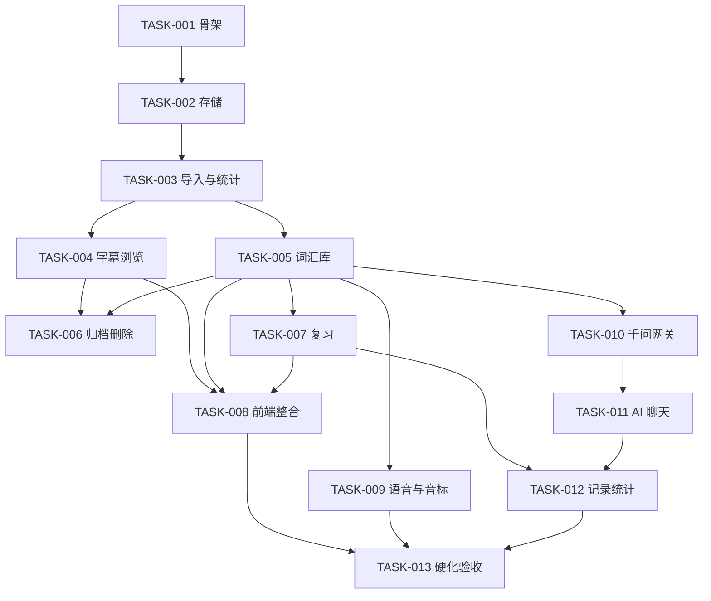

# SceneLingo 开发任务卡索引

| 项目 | 内容 |
| --- | --- |
| 版本 | V0.1（已批准的初始任务计划） |
| 日期 | 2026-10-29 |
| 依据 | SRS V0.2、架构 V0.1、数据库逻辑模型 V0.1 |
| 执行者 | Codex CLI（编码与测试）；Claude Code 只编制任务卡与验收标准 |
| 审批 | 用户（项目负责人），2026-10-29 |
| 授权范围 | **仅 TASK-001 已授权执行**；TASK-002 ~ TASK-013 逐项验收后授权 |

---

## 1. 使用规则

1. 任务卡必须经用户批准后才能开始实现。
2. 一次只执行一张卡；卡与卡之间的依赖未完成时不得跳过。
3. 实现范围以卡中的“实现边界”为准；发现需要扩大范围，先停止并报告，不得自行新增需求。
4. 每张卡完成后由 Codex 提供实现报告与测试输出，再由用户按“人工验收标准”验收。
5. 修改需求、架构或数据模型不在任务卡范围内；发现冲突时报告，不自行改写上游文档。
6. Git 操作遵守 `docs/07-Git协作与版本管理规范.md`；Claude Code 与 Codex 不得并发执行 Git 写操作。

## 2. 任务清单

| 编号 | 名称 | 主要需求 | 依赖 | 对应架构步骤 |
| --- | --- | --- | --- | --- |
| TASK-001 | 本地应用基础骨架、健康检查与安全监听 | FR-001、NFR-006 | — | 0 |
| TASK-002 | 本地存储骨架、迁移与事务 | FR-003、NFR-011 | TASK-001 | 1 |
| TASK-003 | 字幕导入、解析与词形统计 | FR-010 ~ FR-016、BR-SUB-01 ~ 08/10 | TASK-002 | 2 |
| TASK-004 | 字幕库与 cue 浏览 | FR-013、FR-014、BR-SUB-11 | TASK-003 | 2 |
| TASK-005 | 词汇学习库：候选、加词、多语境、详情 | FR-050 ~ FR-056、BR-VOC-01 ~ 07 | TASK-003 | 3 |
| TASK-006 | 字幕归档、删除与冻结语境快照 | FR-018、BR-SUB-12 | TASK-004、TASK-005 | 3 |
| TASK-007 | 复习闭环：队列、评分、间隔、掌握、历史 | FR-060 ~ FR-067、BR-REV-01 ~ 11 | TASK-005 | 4 |
| TASK-008 | 前端整合与离线学习闭环 | FR-013、FR-050 ~ 056、FR-060 ~ 067、NFR-007、NFR-008 | TASK-004 ~ 007 | 5 |
| TASK-009 | 本地语音与 IPA | FR-030、FR-031、FR-040 ~ 042 | TASK-005 | 6 |
| TASK-010 | 千问网关、Keychain、发送计划、翻译/释义/语境解释、缓存与费用 | FR-020 ~ FR-025、FR-078、FR-090 ~ FR-092 | TASK-005 | 7 |
| TASK-011 | AI 聊天完整链：任务模板、自由问答、历史、流式、保存、会话删除 | FR-070 ~ FR-077、BR-AI-01 ~ 11 | TASK-010 | 8 |
| TASK-012 | 学习记录、统计与继续学习 | FR-080 ~ FR-082、BR-REC-01 ~ 07 | TASK-007、TASK-011 | 9 |
| TASK-013 | 硬化与 MVP 验收 | NFR 全体、AT-001 ~ AT-023 | TASK-001 ~ 012 | 10 |

## 3. 依赖关系

## 4. 里程碑

| 里程碑 | 包含 | 可验证结果 |
| --- | --- | --- |
| M1 可启动 | TASK-001、002 | 本机启动、非本机不可访问、重启数据仍在 |
| M2 可导可看 | TASK-003、004 | 导入固定样本，统计正确，可逐条浏览 |
| M3 可学 | TASK-005 ~ 007 | 加词、复习、掌握、历史闭环，全程离线 |
| M4 界面可用 | TASK-008 | 不依赖命令行即可完成核心流程 |
| M5 可用云端 | TASK-009 ~ 011 | 语音、IPA、翻译、AI 问答按确认发送 |
| M6 可验收 | TASK-012、013 | 统计一致、异常矩阵、AT 全跑、隐私检查 |

## 5. 状态维护

- 任务卡状态只允许：`待开始` → `进行中` → `待验收` → `已完成`；阻塞时标 `阻塞` 并写明原因。
- 状态由 Codex 在执行报告中更新，Claude Code 不代改实现状态。
- 未验收的任务不计入里程碑完成。
